# MARSUR-Launcher
Marsur is a fast, customizable Android home screen launcher built around clean spatial navigation, expressive glass and matte surface finishes, and distraction-free daily utilities—without clutter.
Five-Way Spatial Home Screen

    Home: Clean greeting and date header, paired live Clock & Battery cards, an automatic active Media Player widget that appears only while audio is playing, a notification glance pill, up to 4 pinned dock apps, and a docked search bar.

    Swipe Up — App Drawer: Switch between a Multi-Column List, App Icon Grid, or Single-Column list with an interactive Alphabet Wave Scroller (left or right edge). Sort apps alphabetically (A–Z / Z–A), by most used, or recently opened, filter by category, customize icon size, shape (Circle, Squircle, Rounded Square, Soft Tile), and icon style (System Original, Monochrome, Accent Tint), or long-press any app to pin, rename, recategorize, or hide it.

    Swipe Down — Widgets Hub: Build your own scrollable widget board with stackable widgets, three size presets (Compact, Standard, Expanded), reordering, Quick Toggles (Wi-Fi, Bluetooth, Sound, Flashlight), Media Player, Battery & Storage telemetry, Live Notifications Glance, Pinned Apps, Clock & Alarms, Quick Note, and native Android System App Widgets—with a smooth continuous transition for your Clock and Battery cards from Home to Widgets.

    Swipe Left — Briefings (RSS/Atom Reader): Follow curated or custom RSS and Atom feeds, filter by source, read clean in-app article previews, and share stories.

    Swipe Right — Persistent Notes: Capture, pin, search, resize, and share local notes straight from your home screen.

Deep Visual & Layout Personalization
## 📸 Marsur Launcher — Screenshots & Demo

  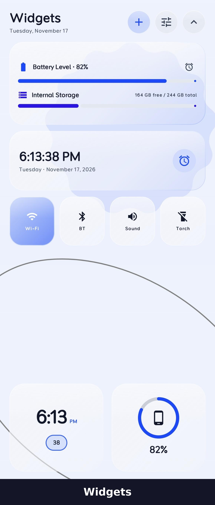
  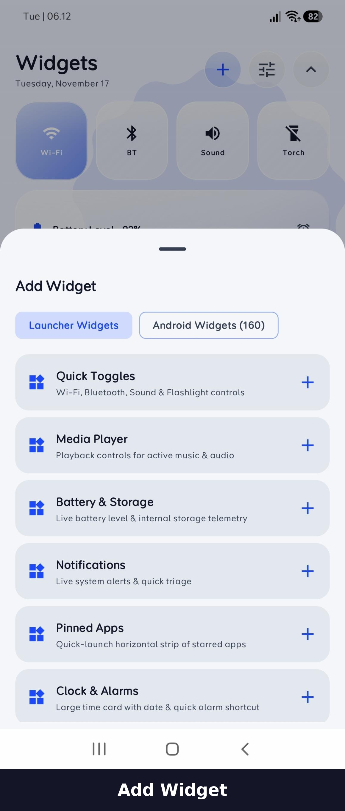
  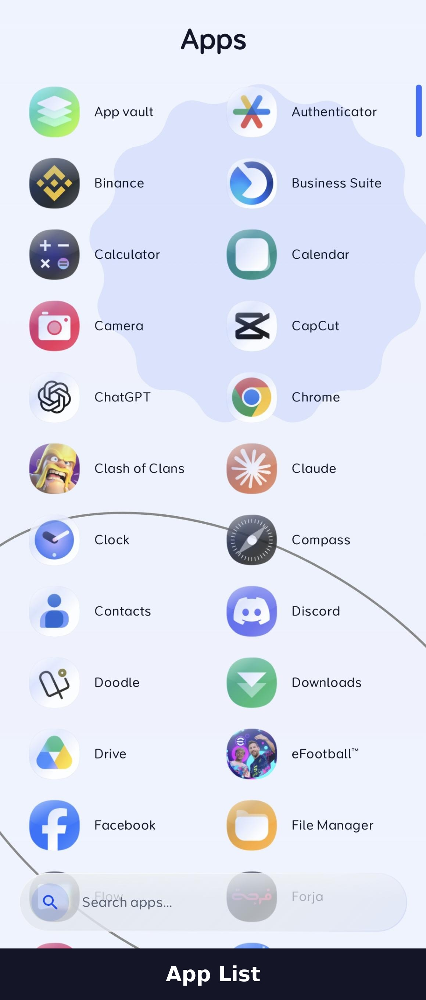
  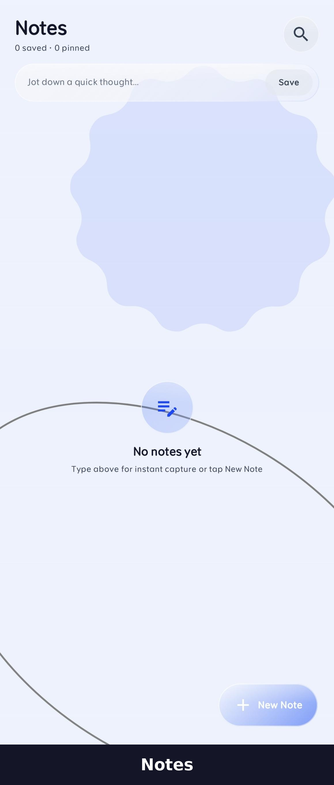
  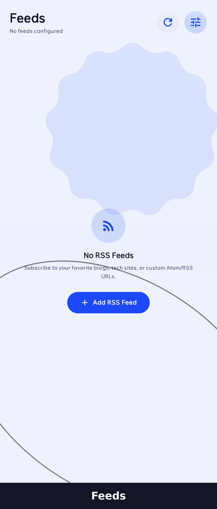
  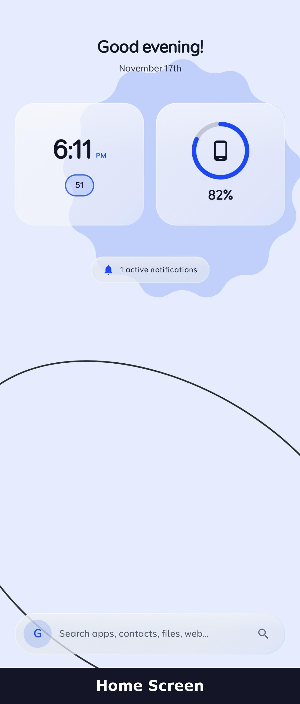
  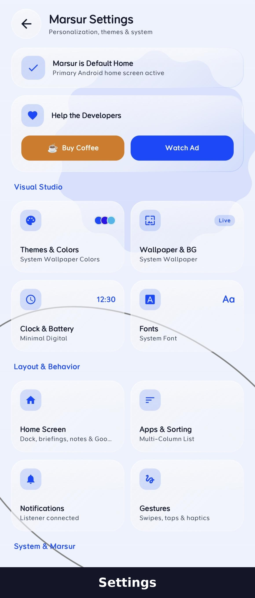
  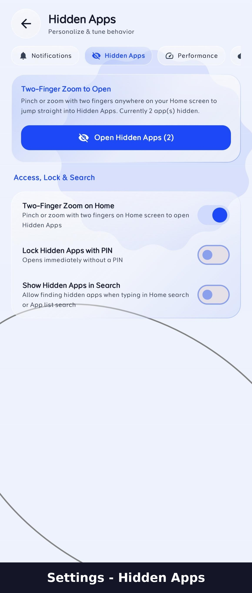
  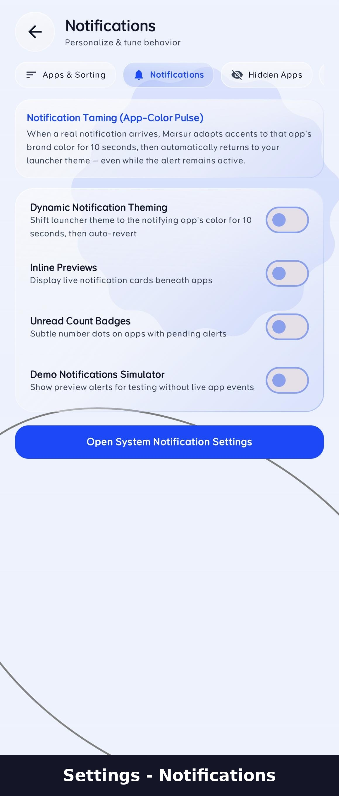
  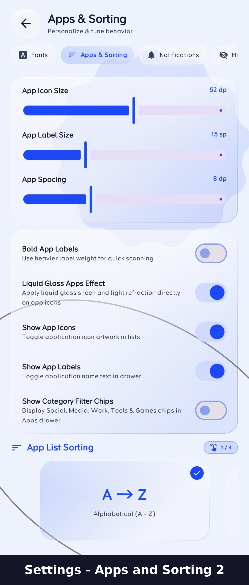
  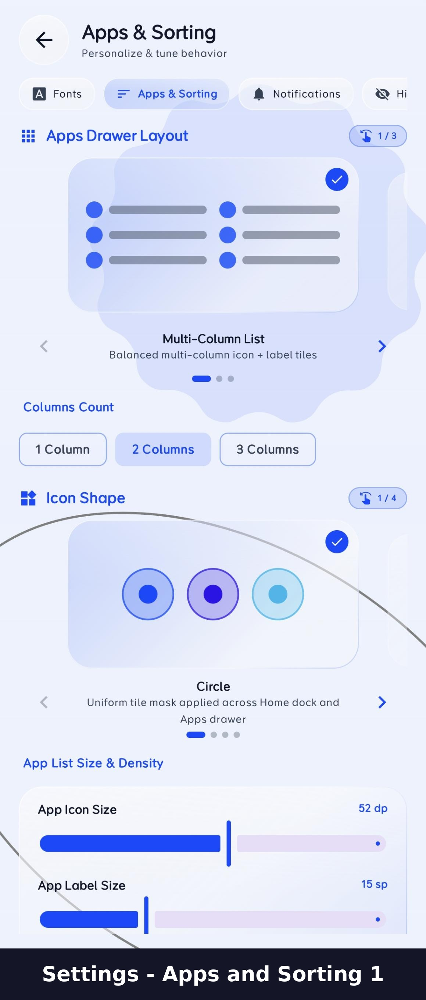
  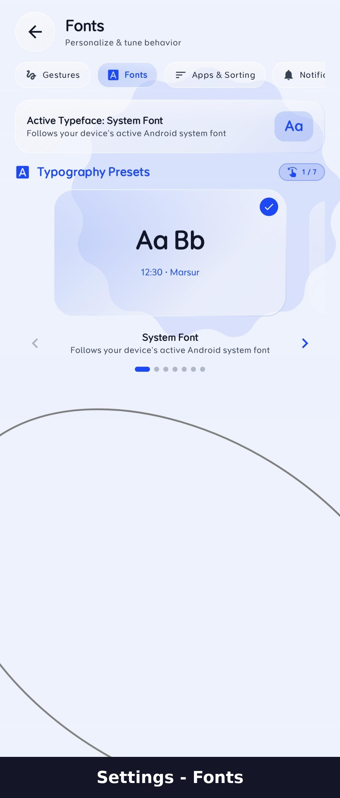
  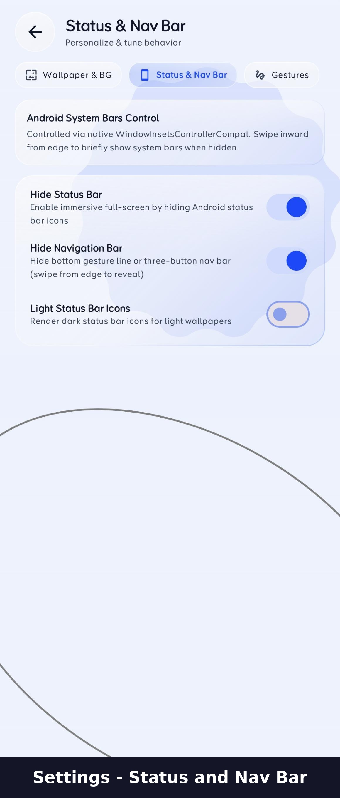
  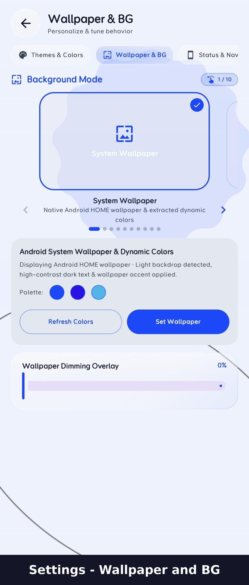
  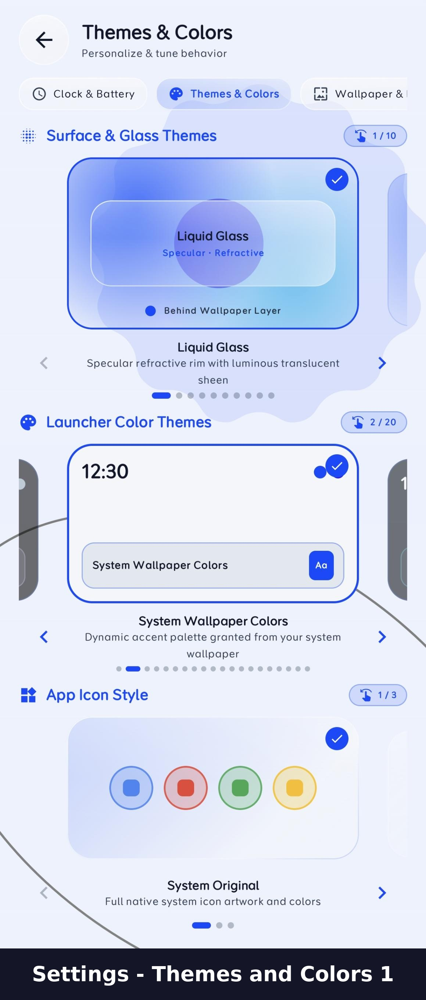
  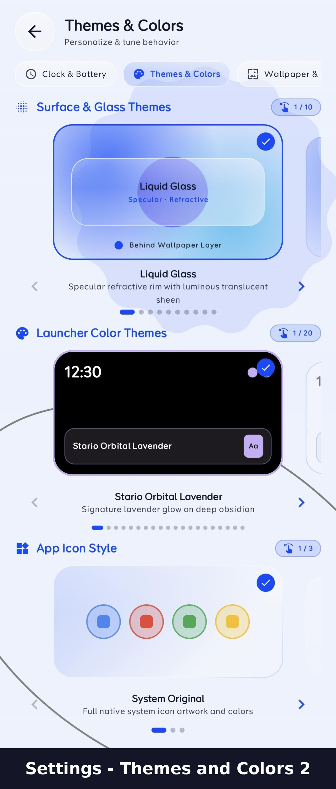
  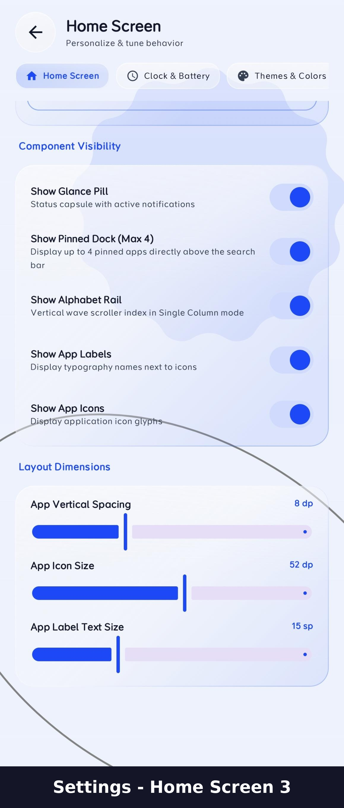
  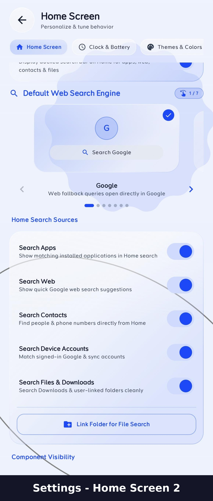
  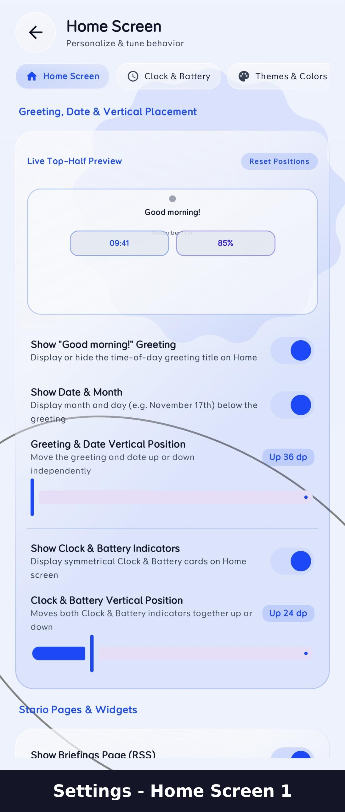
  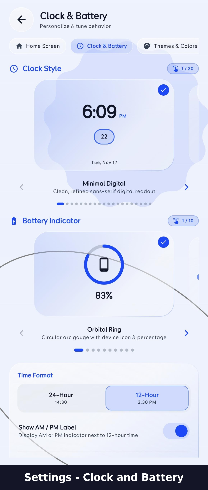

### 🎬 Video Demonstration

[▶️ Watch Marsur Launcher — Clock & Battery Customization](assets/screenshots/21_Settings_Clock_and_Battery_Video.mp4)
    Custom Vertical Placement: Show or hide the time-of-day greeting and date independently, move the greeting/date vertically to clear camera cutouts, and move the paired Clock & Battery cards up or down together on Home.

    20 Clock Styles & 10 Battery Styles: Choose from Minimal Digital, Dot Matrix, Orbital Sweep, Dual Split Pill, Analog Dials, Retro Flip Clock, Binary Matrix, Typography Word Clock, Radial Gauge, and more—paired with 10 live battery indicators (Orbital Ring, Liquid Wave Orb, Speedometer Gauge, Segmented Bars, Dot Matrix Grid, Silicon Cell, and more), 12/24-hour mode, seconds toggle, and scalable sizing.

    10 Surface & Glass Themes: Liquid Glass, Soft Glass, Frosted Glass, Simple Clear, Aurora Prism, Matte Ceramic, Neon Wireframe, Smoked Onyx, Chrome Mirror, and Minimal Ink—applied across cards, backdrop frosting, and optional in-icon glass glazing.

    20 Launcher Color Themes: Includes System Wallpaper Colors dynamic palette extraction, AMOLED Pitch Black, Stario Orbital Lavender, light and dark themes, and high-contrast palettes.

    10 Background & Wallpaper Modes: Native Android System Wallpaper, Custom Gallery Image via Photo Picker, Solid RGB Color, animated Orbital Arcs, Pitch Black AMOLED, and gradients with adjustable dimming.

    7 Typography Presets: System Font, San Francisco, Minimal Sans, Elegant Serif, Futuristic Cyber, Retro Monospace, and Soft Rounded.

    Dynamic Notification Theming: Optionally shifts your launcher accent colors for 10 seconds to match a notifying app's color, then smoothly reverts.

Universal Search, Privacy & Power Controls

    Universal Home Search: Search installed apps, device contacts, accounts, Downloads and user-linked folders, and web queries across 7 selectable search engines (Google, DuckDuckGo, Kagi, Ecosia, Brave Search, Startpage, Perplexity)—plus a built-in inline math & unit conversion calculator and search history.

    Hidden Apps Vault: Hide private apps from the drawer and search, open them with a two-finger zoom gesture on Home, and protect them with a 4-digit PIN.

    Custom Gestures & Ambient Mode: Assign actions to vertical/horizontal swipes, double-tap, single-tap, and long-press, or toggle distraction-free Clean/Ambient Mode.

    System Bars & Performance Profiles: Hide status or navigation bars cleanly, switch between Maximum Smoothness, Balanced Standard, or Ultra Fast / Low-End rendering, and export or restore your entire setup via JSON backup.
